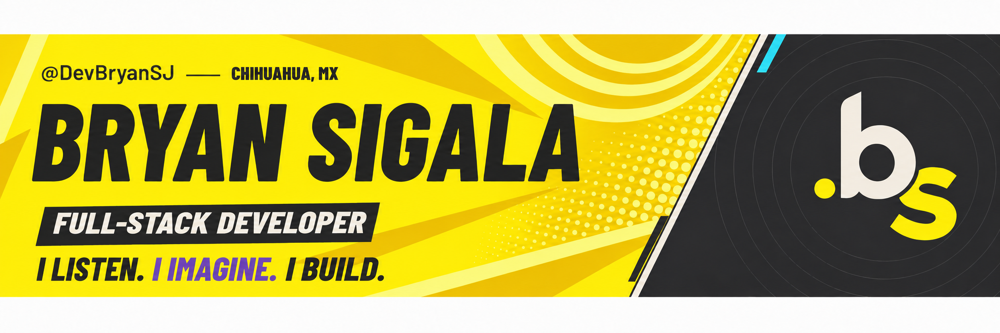
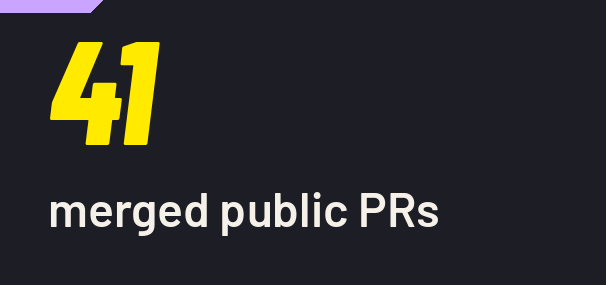

# 

 

I'm Bryan, a full-stack developer based in Chihuahua, Mexico. At **Intelectix**, I work with Angular, .NET, and SQL Server. I like seeing a feature through from start to finish, from figuring out what someone needs to do to designing the screen and writing the code behind it.

I also love JRPGs. If you've ever lingered in a *Persona* menu just to watch what happens when you move the cursor, you already know where my interest in interface design comes from.

## 

  

*Public activity as of November 19, 2026. The count of repositories I own excludes forks.*

- **Chihuahua IT Cluster · 13 PRs.** I adjusted the mobile navigation and fixed text contrast in dark mode. [View the changes](https://github.com/DevBryanSJ/CITC-Landing_Page/pull/7)
- **CashBoom · 8 PRs.** I implemented Google sign-in and later added dynamic questionnaire pages. [Google sign-in](https://github.com/DevBryanSJ/CashBoom/pull/1) · [Questionnaire pages](https://github.com/DevBryanSJ/CashBoom/pull/6)

## 

| Project | My contribution |
| --- | --- |
| [Chihuahua IT Cluster (CITC)](https://github.com/DevBryanSJ/CITC-Landing_Page) | During my internship at Living Lab CUU, I designed the cluster's website in Figma. We reviewed the prototype together before I built the site with Next.js and Motion. |
| [AxisOne ERP](https://github.com/DevBryanSJ/AxisOne_ERP) | I worked on an inventory application built with Next.js and NextAuth. The repository includes an asset management screen with a card for each record. |
| [RiegoTec](https://github.com/DevBryanSJ/RiegoTec2-Web) | For my university community service project, I built a web app that users could install on their phones to control an automated irrigation system. My job was to connect the controls on the screen to the physical equipment. |

## 

At **Intelectix**, I built an application for issuing tax withholding invoices under Mexico's SAT system. I designed the SQL Server data model, built the ASP.NET Core API and Angular interface, and enforced role-based permissions in the API. I also integrated Stripe to handle payments for subscriptions and digital invoice stamps.

Today I work on **practice management software for notarial offices**. One of my favorite parts is learning a procedure well enough to decide which questions a form should ask, in what order, and what the system needs to validate before someone can move on.

**My stack at work** · `Angular` `TypeScript` `RxJS` `C#` `ASP.NET Core` `Entity Framework Core` `SQL Server`

## 

I'm currently studying **full-stack development** at **Master.dev** (formerly FrontendMasters).

I hold a degree in Computer Systems Engineering from **TecNM, Chihuahua II campus**. I studied React and Java in **Encora's** *Spark Internship Program*, then continued with CENALTEC's **Full Stack Foundations** diploma program and **Oracle Next Education**.

I'm digging deeper into **Angular state management** and **design systems**. My personal testing ground is **Portfolio 2.0**, which is still in development. I'm exploring how typography, motion, and a 3D avatar can share a screen while keeping the content easy to find. On the mobile experience page, for example, tapping a role opens its details directly underneath. The avatar comes after the last role.

## 

In 2024, my team and I entered the **NASA Space Apps Challenge** with **ExoFinder**, a website we built to help people learn about exoplanets. In 2026, I became **Training and Community Lead for the Chihuahua organizing team** and got to welcome participants bringing ideas of their own.

I hosted one of our *Space Talks* and designed activities for the bootcamp. In one exercise, participants shared what each person could bring to a team, picked a challenge, and drafted a proposal to discuss with mentors. I enjoy helping a team go from “we want to take part” to “we know where to start.”
