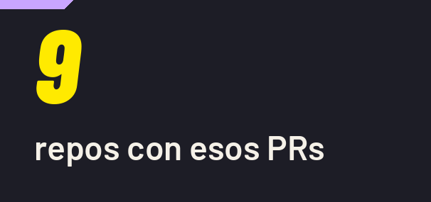
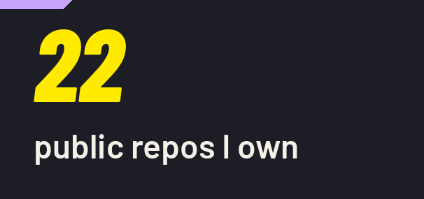

# 

 

Soy Bryan, desarrollador full-stack en Chihuahua, México. Trabajo en **Intelectix** con Angular, .NET y SQL Server. Me gusta seguir una funcionalidad de principio a fin, desde entender qué necesita hacer una persona hasta diseñar la pantalla y escribir la lógica que la hace funcionar.

También me gustan los JRPG. Si alguna vez te has detenido en el menú de *Persona* solo para ver cómo cambia una selección, ya entiendes de dónde viene mi interés por el diseño de interfaces.

## 

  

*Actividad pública acumulada al 19 de noviembre de 2026. Los repositorios propios excluyen forks.*

- **Chihuahua IT Cluster · 13 PRs.** Ajusté la navegación móvil y corregí el color del texto en el tema oscuro. [Ver el cambio](https://github.com/DevBryanSJ/CITC-Landing_Page/pull/7)
- **CashBoom · 8 PRs.** Implementé el inicio de sesión con Google y después añadí páginas dinámicas para cuestionarios. [Ver autenticación](https://github.com/DevBryanSJ/CashBoom/pull/1) · [Ver cuestionarios](https://github.com/DevBryanSJ/CashBoom/pull/6)

## 

| Proyecto | Qué hice |
| --- | --- |
| [Chihuahua IT Cluster (CITC)](https://github.com/DevBryanSJ/CITC-Landing_Page) | En mis prácticas en Living Lab CUU diseñé la página del clúster en Figma. Revisamos el prototipo antes de que lo implementara con Next.js y Motion. |
| [AxisOne ERP](https://github.com/DevBryanSJ/AxisOne_ERP) | Trabajé en una aplicación de inventarios con Next.js y NextAuth. En el repositorio se puede ver la pantalla de activos con tarjetas para consultar cada registro. |
| [RiegoTec](https://github.com/DevBryanSJ/RiegoTec2-Web) | Durante mi servicio social desarrollé una aplicación web instalable en el celular para controlar un sistema de riego automatizado. Ahí me tocó conectar lo que hacía el usuario en la pantalla con el equipo físico. |

## 

En **Intelectix** desarrollé una aplicación de facturación de retenciones del SAT. Diseñé el modelo de datos en SQL Server, construí la API con ASP.NET Core y la interfaz con Angular. Definí qué podía hacer cada usuario, apliqué esos permisos en la API e integré Stripe para el cobro de suscripciones y timbres.

Hoy trabajo en software de **gestión para notarías**. Una de las partes que más me interesa es entender un trámite lo suficiente para decidir qué pedir en un formulario, en qué orden y qué debe validar el sistema antes de que la persona continúe.

**Stack de trabajo** · `Angular` `TypeScript` `RxJS` `C#` `ASP.NET Core` `Entity Framework Core` `SQL Server`

## 

Estoy cursando una formación en **desarrollo Full Stack** en **Master.dev** (antes FrontendMasters).

Soy ingeniero en Sistemas Computacionales por el **TecNM, campus Chihuahua II**. Me formé en React y Java con el programa *Spark Internship* de **Encora** y continué con el diplomado **Full Stack Foundations** de CENALTEC y **Oracle Next Education**.

Ahora profundizo en **manejo de estado en Angular** y **sistemas de diseño**. Mi laboratorio personal es el **Portafolio Web 2.0**, todavía en desarrollo. Ahí pruebo cómo combinar tipografía, movimiento y un avatar 3D sin quitarle espacio a lo que alguien llegó a ver. Por ejemplo, en la vista móvil de experiencia, el detalle de cada puesto se abre justo debajo de la opción que tocaste. El avatar espera al final.

## 

En 2024 participé en el **NASA Space Apps Challenge** con **ExoFinder**, un sitio que desarrollamos en equipo para aprender sobre exoplanetas. En 2026, como **líder de Formación y Comunidad del equipo organizador de Chihuahua**, me tocó acompañar a quienes llegaban con sus propias ideas.

Fui maestro de ceremonias en una de las *Space Talks* y preparé actividades para el bootcamp. Una de ellas consistía en que los participantes compartieran qué sabía hacer cada quien, eligieran un reto y salieran con un primer anteproyecto para discutir con mentores. Disfruto ayudar a un equipo a pasar de «queremos participar» a «ya sabemos por dónde empezar».
